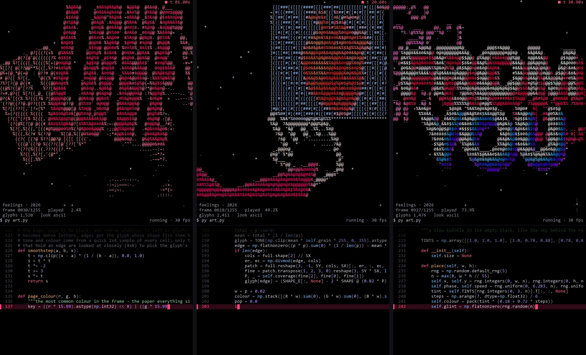
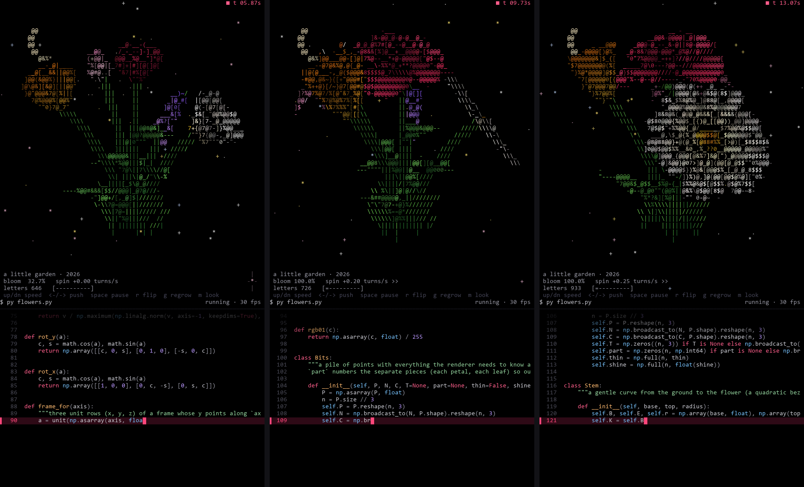

# terminal-art

Your pink edit (`feelings.mp4`), re-drawn live as ASCII art in the terminal, in the
same style as the rose video: glyph art on black with twinkling stars, a little
HUD, and the program typing out its own source code underneath while it plays.
The song plays along in sync.

```
python art.py
```

It plays the signed copy (`feelings_for_you.mp4`, see `sign.py` below) when it's there,
and when the closing card comes up it draws **@chitrivjr** big enough to read, moving
the way the card does. `--no-sign` leaves the card as it is in the video.



## For someone: `for_you.py`

Double-click **`for_you.bat`**. A card opens on a starry night: *i grew some*,
a big handwritten **flowers** that writes itself in, then *for you ♥*.
Press **Enter** and the card glitches and bursts into glitter. Then the garden grows,
blooms, and turns slowly, with the edit and its song playing beside it. When the
song ends, the card comes back.

| key | does |
| --- | --- |
| `Enter` | begin |
| `↑` / `↓` | turn faster / slower |
| `r` | play it all again |
| `q` | close |

```
python for_you.py --autostart 6   begins by itself after 6 seconds (no keys needed)
python for_you.py --mute          no sound
```

To send it as a video: start it with `--autostart 6`, then record the window with
`Win` + `Alt` + `R` (Xbox Game Bar records the sound too).

### Your name on the ending: `sign.py`

The edit ends on a pink card with a handle on it. To put yours there instead:

```
python sign.py @chitrivjr
```

- It writes **`feelings_for_you.mp4`**: the same edit, with the new name on the closing
  card. The card's motion (it slides up blurred, flashes twice, bounces, settles) is
  measured frame by frame and the new name is put through exactly the same, so it
  looks native. The song is copied across untouched, and `feelings.mp4` itself is never changed.
- It also saves **`signature.npz`** (the name as a picture, plus that motion). At
  terminal size the card's lettering would be a smudge, so when the card comes up the
  gift draws the name big, in glyph letters, bouncing in time with the edit.
- `for_you.py` plays the signed copy automatically when it's there. Run
  `python make_gift.py` again afterwards to put it in the `.exe`.

(Needs Pillow: `pip install pillow`. `art.py` still plays the original `feelings.mp4`;
`python art.py feelings_for_you.mp4` plays the signed one.)

### On the web: `web/`

The same gift as a website that opens on any phone or computer, with nothing to
download: drag the **`web`** folder onto **app.netlify.com/drop**. It's the Python
rewritten in JavaScript, drawn on a canvas, with the edit and the song playing in the page.

When the song ends, the card comes back with three choices: **again**, **the garden**
(`flowers.py` on its own, with Reflections), and **the edit** (`art.py` on its own,
typing its own code). `Esc` or "‹ back" returns to the card. Each has its own link:
`…netlify.app/#garden` and `…netlify.app/#edit` open straight into them.

Phones: tap to begin, swipe up or down to change the spin speed (sideways in the garden
pushes it), and the words in the garden's and the edit's bottom lines are buttons.

### Sending the real thing: `dist/for you.exe`

One 50 MB file with everything inside: Python, the song, the edit (signed, if you ran
`sign.py`) and the flowers.
It runs on any **Windows 10 or 11** PC with a double-click; nothing to install.

- **Send it** as a Google Drive / OneDrive link, or as a *document* on Telegram or
  WhatsApp. Gmail and some chat apps refuse `.exe` files; a Drive link always works.
- **The first time it opens**, Windows says *"Windows protected your PC"*, because
  the file isn't signed by a company. Click **More info → Run anyway**. Some
  antivirus apps are wary of home-made `.exe` files too; that's normal for apps built
  this way, so tell them it's from you.
- It shows a black window for a few seconds while it unpacks, then the card appears.
  **Sound on.**
- On a Mac or a phone it can't run. Send the screen recording instead.

To rebuild it after changing anything: `pip install pyinstaller numpy imageio-ffmpeg pillow`,
then `python make_gift.py`. (`build/` is just its cache and can be deleted any time.)

## The garden: `flowers.py`

A little bouquet grows out of the dark under a starry sky, with a moon, fireflies
and the odd shooting star. Stems rise and throw off glitter, leaves unfold, buds
open: a rose, a tulip, a daisy, a lily and a sprig of lavender. Once everything
has bloomed, the whole bouquet starts spinning, and you steer it.

```
python flowers.py
```

(or double-click `flowers.bat`)

It grows to **"Reflections" by Malcolm Todd**, 0:38-1:15 (`reflections.m4a`). That part
is cut so its last second and a half melts into the music just before 0:38, so it loops
with no seam for as long as the garden turns. The music starts 0.39 s before the garden,
so the bouquet starts to spin on the big beat at 9.5 s; `g` (regrow) restarts both
together. `--mute` for silence, `--song other.m4a` for something else.

| key | does |
| --- | --- |
| `↑` / `↓` (or `+` / `-`) | spin faster / slower |
| `→` / `←` | push the spin to the right / left (goes through a stop and the other way) |
| `space` | pause / carry on |
| `r` | reverse |
| `g` | grow it all again from bare soil |
| `m` | switch look: `hd` pixels / `letters` |
| `c` | show / hide the code |
| `q` | quit |

```
python flowers.py --speed 0.6     start spinning faster (turns per second, minus = the other way)
python flowers.py --look hd       start in the hd pixel look instead of letters
python flowers.py --no-code       just the garden, much bigger
python flowers.py --tag "@you"    your credit line in the corner
```

Two looks:

- **`letters`** (default): glyph art like the rose. Each cell's character is
  picked by matching its shape to the flower's edge inside that cell.
- **`hd`**: every character cell is two shaded pixels, split top/bottom (`▀`) or
  left/right (`▌`), whichever fits the picture better. That's double the
  resolution, with every pixel lit and anti-aliased from 8 samples.

Want even more detail? Detail = number of character cells. Make the window bigger
and the font smaller (in cmd: right-click the title bar > Properties > Font; in
VS Code or Windows Terminal: `Ctrl` + `-`). Every extra cell is two more pixels.
cmd uses 256 colours automatically to stay quick. Add `--colours 24` for smoother
shading if your PC keeps up.

Unlike `art.py`, nothing here comes from a video: every petal is a curved 3D
sheet worked out by the code, lit by two lamps, and drawn cell by cell. It needs
`art.py` in the same folder (it borrows the screen and keyboard code).



## Setup (once)

```
pip install -r requirements.txt
```

That's `numpy` plus `imageio-ffmpeg` (a bundled ffmpeg, so nothing else to install).
If you already have `ffmpeg` on your PATH, that one is used instead.

## Keys while it plays

| key | does |
| --- | --- |
| `q` / `Esc` | quit |
| `m` | switch look: `ascii` (glyphs, like the rose) / `pixels` (sharp colour blocks) |
| `c` | show / hide the code pane |

## Options

```
python art.py --look pixels       start in the colour-block look
python art.py --no-code           art only, bigger picture
python art.py --loop              play forever
python art.py --tag "@yourname"   your credit line in the corner
python art.py --start 20          start 20 seconds in
python art.py --mute              no sound
python art.py other_clip.mp4      any video works
python art.py --help              everything else
```

## Getting the best look

- **Terminal:** Windows Terminal (free in the Microsoft Store) or the VS Code
  terminal give full 24-bit colour and the smoothest frame rate. The classic
  PowerShell/cmd window works too: the program switches to 256 colours there,
  because the old console is much slower with full colour.
- **More detail:** the art is drawn one character per cell, so a smaller font
  means a sharper picture. Zoom out with `Ctrl` + mouse wheel (or `Ctrl -`) and
  make the window bigger. The layout re-flows live when you resize.
- **For a reel:** a tall, narrow window puts the art on top and the code below,
  exactly like the rose video. A wide window puts them side by side.
- **Sound out of sync?** `--sync 0.1` delays the picture by 0.1 s (use a
  negative number to do the opposite).
- The status line shows the real frame rate. On a slow PC it drops frames
  rather than falling behind, so the picture always stays with the music.

## How it works

1. ffmpeg decodes and scales each frame to exactly the terminal's size
   (a 4x8 pixel patch for every character cell).
2. The most common colour in the frame is treated as "the page" and wiped to
   black. Everything else becomes ink: how far a pixel is from the page colour
   sets how dense its glyph is, so bold text turns into `@ & $ %` and faint
   tints into `. : ~`.
3. Cells that contain an edge are compared against the actual shapes of the
   characters (a table measured from a monospace font), so a slanted edge
   gets `/`, a floor gets `_`, a curve gets `(`.
4. Photo-like frames (the memes) switch to brightness shading instead.
5. Only the cells that changed since the last frame are sent to the terminal,
   and a separate thread writes to the console while the next frame is drawn.

`feelings.mp4` is the edit you sent (credit: @sumithsai_, from its end card).
`feelings_for_you.mp4` is the copy re-signed by `sign.py`. `reflections.m4a` is 0:38-1:15 of
"Reflections" by Malcolm Todd.
